<picture>
  <source media="(prefers-color-scheme: dark)" srcset="banner-dark.svg">
  
</picture>

I am a PhD researcher at the [Pyrenean Institute of Ecology (IPE-CSIC)](https://www.ipe.csic.es/) in Zaragoza, in the [Laboratory of Climatology and Climate Services](https://lcsc.csic.es/). I study how hydrological drought propagates through river networks: where it starts, how it moves downstream, and what controls the delay between one reach and the next.

[Website](https://alexcrespillo.github.io/Webpage/) · [CV](https://alexcrespillo.github.io/Webpage/Cv/CV_Alex_Crespillo_english.pdf) · [ORCID](https://orcid.org/0009-0009-3918-8702) · [ResearchGate](https://www.researchgate.net/profile/Alex-Crespillo) · [LinkedIn](https://www.linkedin.com/in/alexcrespillo) · [alex@ipe.csic.es](mailto:alex@ipe.csic.es)

### Research

My thesis follows hydrological drought through the river network in four steps, from measuring it to predicting it:

1. **Tracking propagation, event by event.** Droughts identified at each gauge from daily streamflow and matched between nested gauges along the network. *Published.*
2. **How propagation has changed** over recent decades, in river networks across Europe and beyond. *In preparation.*
3. **What controls it:** network structure, catchment storage, groundwater, snow and river regulation. *Ongoing.*
4. **Predicting it** with machine learning, from upstream signals to downstream reaches. *Planned.*

### Code

- [**Code_v.1**](https://github.com/AlexCrespillo/Code_v.1): the full pipeline of *Tracking hydrological drought propagation in river networks: an event-based framework* (Journal of Hydrology, 2026). MIT licence, archived on Zenodo. 

### Selected publications

- **Crespillo López, A.**, Vicente-Serrano, S. M., Gimeno, L. (2026). Tracking hydrological drought propagation in river networks: an event-based framework. *Journal of Hydrology*, 680, 136544. [doi:10.1016/j.jhydrol.2026.136544](https://doi.org/10.1016/j.jhydrol.2026.136544)
- Vicente-Serrano, S. M., et al., including **Crespillo, A.** (2026). Non-stationary dry-spell hazard probabilities for Spain. *International Journal of Climatology*, e70393. [doi:10.1002/joc.70393](https://doi.org/10.1002/joc.70393)
- Vicente-Serrano, S. M., et al., including **Crespillo, A.** (2025). Developing science-informed maps and climate service for extreme rainfall in Spain. *Natural Hazards*, 121, 23281–23302. [doi:10.1007/s11069-025-07731-0](https://doi.org/10.1007/s11069-025-07731-0)

The full list, with talks, is on my [website](https://alexcrespillo.github.io/Webpage/#publications).

### Tools

Python and R for hydrological and climate time series and extreme-value statistics · scikit-learn, PyTorch, TensorFlow and Keras · river networks from digital elevation models, ArcGIS · large data volumes and GPU computing · Git, LaTeX, Streamlit, Plotly
